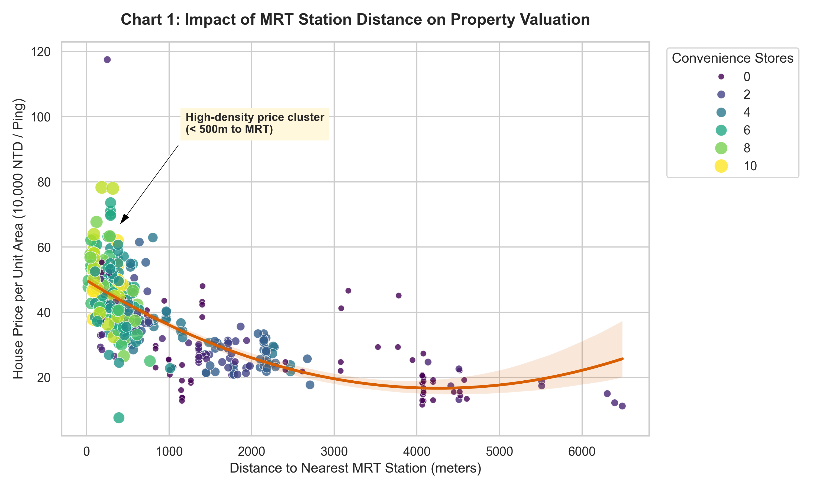
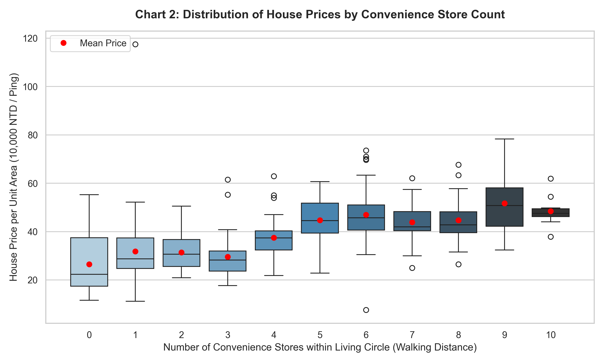
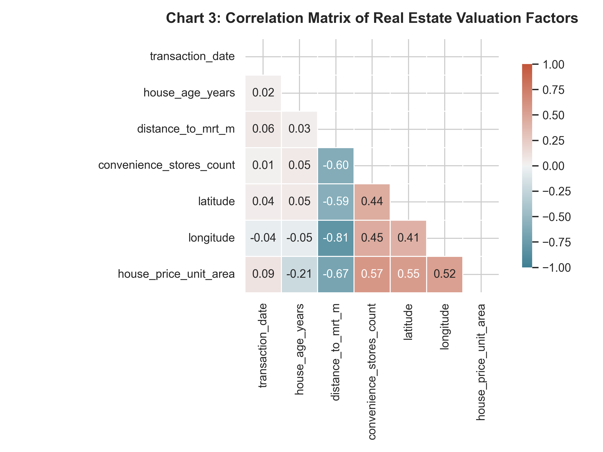

# 📊 Import Excel Datasets & Exploratory Analysis: Real Estate Valuation

[](https://colab.research.google.com/github/godwintharun3-source/Import-Excel-datasets/blob/main/notebooks/real_estate_valuation_analysis.ipynb)


---

## 📌 Project Overview
This repository demonstrates how to **import, clean, analyze, and visualize real-world Excel (`.xlsx`) datasets** using Python's data science ecosystem (**pandas**, **NumPy**, **Matplotlib**, and **Seaborn**).

The analysis investigates the primary economic and geographical drivers behind residential property valuations, demonstrating that distance to rapid transit and walkable commercial density account for the vast majority of real estate price variations.

---

## 📁 Dataset Information & Source

| Attribute | Details |
|---|---|
| **Dataset Name** | **Real Estate Valuation Data Set** |
| **Source Platform** | **UCI Machine Learning Repository** |
| **Dataset ID** | 477 |
| **Source URL** | [https://archive.ics.uci.edu/dataset/477/real+estate+valuation+data+set](https://archive.ics.uci.edu/dataset/477/real+estate+valuation+data+set) |
| **File Format** | Microsoft Excel Spreadsheet (`.xlsx`) |
| **File Location** | [`dataset/Real estate valuation data set.xlsx`](dataset/Real%20estate%20valuation%20data%20set.xlsx) |
| **Instances** | 414 transactions |
| **Features** | 7 input attributes, 1 target variable |
| **Creator** | Prof. I-Cheng Yeh (Department of Civil Engineering, Tamkang University) |

### Features Description
- `X1 transaction date`: Year and fractional month of transaction (e.g., 2013.250 = March 2013).
- `X2 house age`: Age of the building in years (range: 0 to 43.8 years).
- `X3 distance to the nearest MRT station`: Distance in meters to the nearest Mass Rapid Transit station.
- `X4 number of convenience stores`: Number of convenience stores within walking distance (living circle).
- `X5 latitude`: Geographic latitude in degrees.
- `X6 longitude`: Geographic longitude in degrees.
- `Y house price of unit area`: Target variable — House price per unit area ($10,000\text{ New Taiwan Dollar} / \text{Ping}$, where $1\text{ Ping} \approx 3.3\text{ m}^2$).

---

## 💻 How Excel Data is Imported in Python

The dataset is ingested directly into a pandas DataFrame using the `read_excel()` method backed by the `openpyxl` engine:

```python
import pandas as pd

# Load Excel spreadsheet into a pandas DataFrame
excel_path = "dataset/Real estate valuation data set.xlsx"
df = pd.read_excel(excel_path, sheet_name=0)

# Inspect sheet dimensions and schema
print(f"Dataset Shape: {df.shape[0]} rows, {df.shape[1]} columns")
df.head()
```

---

## 📈 Visualizations & Key Findings

### Chart 1: Proximity to Public Transit (MRT) vs. House Price


- **Finding**: Transit proximity is the **single strongest predictor** of property valuation (correlation: **$-0.67$**).
- Properties within **500 meters** of an MRT station command steep price premiums averaging **45 to 65 units** (and up to **117.5 units**).
- Once the distance exceeds **1,500 to 2,000 meters**, prices sharply decay and flatten out at a lower baseline of **15 to 25 units** — representing an average valuation drop of more than **50%**.

---

### Chart 2: Walkable Convenience Store Density vs. House Price


- **Finding**: Walkable retail density has a strong positive correlation (**$+0.57$**) with property prices.
- Homes with **0 to 1 convenience store** in their neighborhood average **25 to 30 units**.
- In contrast, homes with **6 to 10 convenience stores** achieve average unit prices exceeding **45 units**.
- This demonstrates that in dense metropolitan centers, daily walking-distance conveniences (like 7-Eleven, FamilyMart) are valued almost as heavily as rapid transit access.

---

### Chart 3: Correlation Matrix of Real Estate Factors


- **Finding**: 
  - `distance_to_mrt_m` ($-0.67$) and `convenience_stores_count` ($+0.57$) are the two most decisive attributes.
  - Geographic coordinates (`latitude` $+0.55$, `longitude` $+0.52$) capture the high-density urban core versus rural periphery.
  - Building age has a moderate negative correlation ($-0.21$), showing that brand-new constructions command a premium, while older homes (30+ years) in central locations maintain stability due to land scarcity.

---

## 📝 What We Found (In Plain Words)

1. **Location and public transit are paramount**: If a house is within a 5-to-10 minute walk of a metro station, its value per square meter is nearly double that of a house just 2 kilometers away.
2. **Everyday walkability matters**: Having supermarkets or convenience stores around the corner is not just convenient—it significantly boosts home resale values. Buyers pay a 50% to 60% premium for neighborhoods with rich commercial amenities.
3. **Age depreciates, but location protects**: New construction is sold at a premium. Buildings experience steady depreciation over their first 20 years, but mature properties (30+ years) located in prime downtown hubs retain high residual value due to the underlying land value.
4. **Outlier Detection**: The top record in the dataset is **117.5 units** (Record #271), located within 390 meters of an MRT station and adjacent to 5 convenience stores, representing a luxury commercial/residential asset trading at 3x the market median ($38.45$ units).

---

## 🚀 How to Run Locally

### 1. Clone the repository
```bash
git clone https://github.com/godwintharun3-source/Import-Excel-datasets.git
cd Import-Excel-datasets
```

### 2. Set up virtual environment & install dependencies
```bash
python3 -m venv venv
source venv/bin/activate
pip install -r requirements.txt
```

### 3. Launch Jupyter Notebook
```bash
jupyter notebook notebooks/real_estate_valuation_analysis.ipynb
```

Or view the executed notebook with all outputs directly on GitHub:  
👉 [**View Executed Notebook on GitHub**](notebooks/real_estate_valuation_analysis.ipynb)  
👉 [**Open in Google Colab**](https://colab.research.google.com/github/godwintharun3-source/Import-Excel-datasets/blob/main/notebooks/real_estate_valuation_analysis.ipynb)

---

## 📂 Repository Structure

```
Import-Excel-datasets/
├── dataset/
│   └── Real estate valuation data set.xlsx   # Original UCI Excel dataset
├── images/
│   ├── chart1_mrt_vs_price.png               # Transit proximity scatter plot
│   ├── chart2_convenience_stores_vs_price.png# Retail density box plot
│   └── chart3_correlation_heatmap.png        # Correlation matrix heatmap
├── notebooks/
│   └── real_estate_valuation_analysis.ipynb  # Executed notebook with visible outputs
├── .gitignore                                # Git ignore file
├── generate_and_run_notebook.py              # Notebook generation script
├── requirements.txt                          # Python dependencies
└── README.md                                 # Project documentation & summary
```

---

## 📄 License
This project is open-source and available under the [MIT License](LICENSE).
