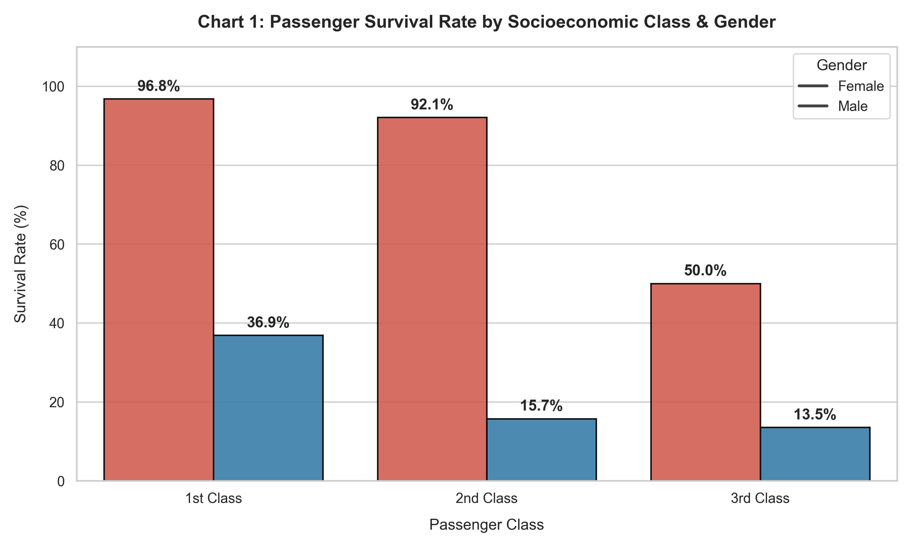
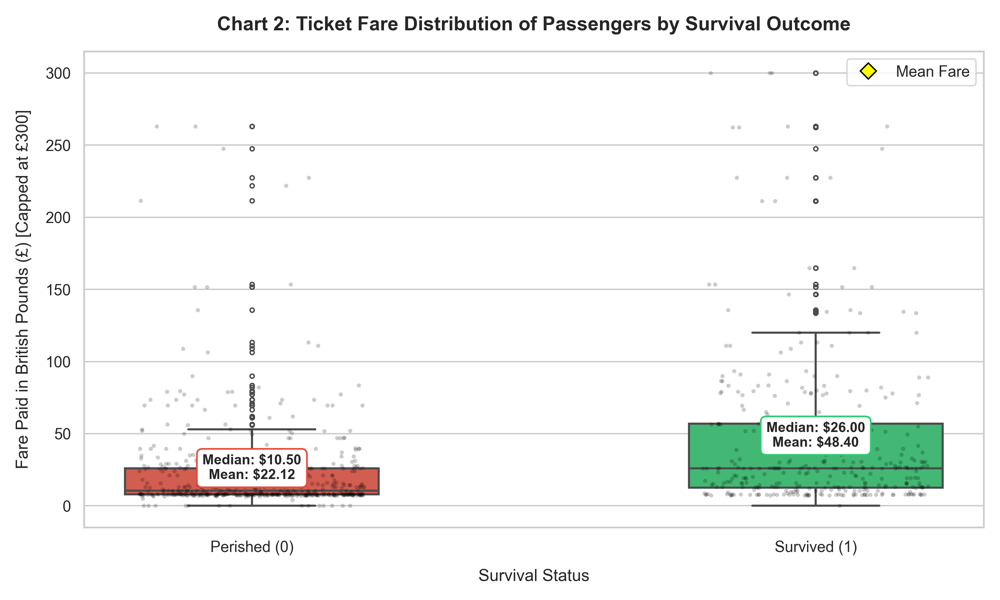
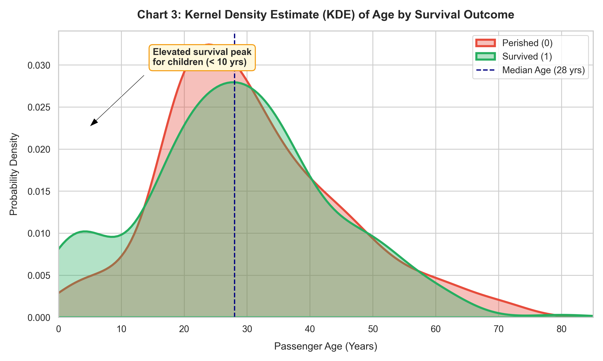

# 🚢 Import CSV Files & Exploratory Data Analysis: Kaggle Titanic Dataset

[](https://colab.research.google.com/github/godwintharun3-source/Import-CSV-files/blob/main/notebooks/titanic_csv_import_analysis.ipynb)


---

## 📌 Project Overview
This repository satisfies the practical requirements for **Module 3: NumPy & Pandas — Import CSV files** from the [Training Trains Data Science Internship](https://trainingtrains.com/internship/paths/numpy-and-pandas/3).

The project demonstrates how to **ingest, inspect, clean, query, and visualize real-world CSV (`.csv`) datasets** using Python's core data science libraries (**pandas**, **NumPy**, **Matplotlib**, and **Seaborn**).

Using the world-renowned **Titanic Passenger Dataset** sourced from **Kaggle**, this project explores how socioeconomic class, ticket pricing, gender, and age dictated survival probabilities during the historic maritime event.

---

## 🧠 Core Pandas Concepts & Key Terms

> **"Pandas gives labelled tables for data analysis."**  
> *Analogy:* **A DataFrame is an Excel sheet you can command with Python.**

| Term / Method | Classification | Description & Purpose | Code Syntax |
|---|---|---|---|
| `Series` | Data Structure | Labelled 1D array; represents a single column with an index. | `pd.Series([85, 92, 78], name="marks")` |
| `DataFrame` | Data Structure | 2D labelled tabular structure with heterogeneous columns and rows. | `pd.DataFrame({"name": ["Alice", "Bob"], "marks": [88, 92]})` |
| `read_csv()` | I/O Function | Reads a delimited text/CSV file directly into a pandas DataFrame. | `df = pd.read_csv("dataset/titanic.csv")` |
| `read_excel()` | I/O Function | Ingests Excel workbooks (`.xlsx`, `.xls`) with sheet-level selection. | `df = pd.read_excel("data.xlsx", sheet_name=0)` |
| `read_json()` | I/O Function | Parses nested or flat JSON objects and API payloads into tabular form. | `df = pd.read_json("records.json")` |
| `head(n)` | Inspection Method | Displays the first $n$ rows of a DataFrame (default $n=5$). | `df.head(10)` |
| `shape` | Attribute | Tuple `(rows, columns)` indicating table dimensions. | `df.shape` |
| `info()` | Inspection Method | Prints concise summary: column names, data types, non-null counts, and memory usage. | `df.info()` |
| `describe()` | Inspection Method | Generates descriptive summary statistics (count, mean, std, min, 25%, 50%, 75%, max). | `df.describe()` |

---

## 📁 Dataset Information & Source

| Attribute | Details |
|---|---|
| **Dataset Name** | **Titanic: Machine Learning from Disaster** |
| **Source Platform** | **Kaggle** |
| **Direct URL** | [https://www.kaggle.com/c/titanic](https://www.kaggle.com/c/titanic) |
| **File Format** | Comma-Separated Values (`.csv`) |
| **File Location** | [`dataset/titanic.csv`](dataset/titanic.csv) |
| **Total Records** | 891 passengers (instances) |
| **Total Features** | 12 columns (1 target variable, 11 input attributes) |

### Features Description
- `PassengerId`: Unique integer identifier for each passenger.
- `Survived`: Target binary outcome (`0` = Perished, `1` = Survived).
- `Pclass`: Ticket/Socioeconomic class (`1` = 1st Class / Upper, `2` = 2nd Class / Middle, `3` = 3rd Class / Steerage).
- `Name`: Full passenger name including titles (Mr., Mrs., Miss., Master, etc.).
- `Sex`: Biological gender (`male`, `female`).
- `Age`: Fractional or integer age in years.
- `SibSp`: Number of siblings or spouses traveling aboard the Titanic.
- `Parch`: Number of parents or children traveling aboard the Titanic.
- `Ticket`: Ticket number string.
- `Fare`: Passenger ticket fare in British Pounds (£).
- `Cabin`: Cabin number / deck allocation (contains missing entries).
- `Embarked`: Port of embarkation (`C` = Cherbourg, `Q` = Queenstown, `S` = Southampton).

---

## 💻 How CSV Data is Imported in Python

The dataset is ingested directly into a pandas DataFrame using the `pd.read_csv()` function:

```python
import pandas as pd

# Ingest CSV file into a 2D labelled DataFrame
csv_path = "dataset/titanic.csv"
df = pd.read_csv(csv_path)

# Inspect shape and verify first rows
print(f"Dataset Shape: {df.shape[0]} rows x {df.shape[1]} columns")
display(df.head())
```

### Creating DataFrames from Scratch
Pandas allows effortless creation of tabular structures from native Python dictionaries:

```python
# Create a DataFrame using key-value pairs of column names and lists
students_df = pd.DataFrame({
    "name": ["Alice", "Bob", "Charlie", "Diana"],
    "marks": [88, 92, 79, 95]
})
print(students_df)
```

---

## 📈 Visualizations & Analytical Findings

### Chart 1: Survival Rate by Passenger Class & Gender


- **Finding**: 
  - Gender was the most significant determinant of survival due to the *"women and children first"* protocol.
  - **1st Class Females** achieved an extraordinary **96.8% survival rate** (91 out of 94 survived).
  - **2nd Class Females** followed closely with a **92.1% survival rate** (70 out of 76 survived).
  - **3rd Class Males** suffered the lowest survival odds at **13.5%** (only 47 out of 347 survived).
  - A first-class female passenger was **over 7 times more likely** to survive than a third-class male passenger.

---

### Chart 2: Ticket Fare Distribution of Survivors vs. Non-Survivors


- **Finding**: 
  - Passengers who survived paid an average ticket fare of **£48.40** (median: **£26.00**), more than **double** the average fare of £22.12 (median: **£10.50**) paid by those who perished.
  - Wealthier passengers occupied upper decks closer to the lifeboats, had access to private stewards, and were informed of the collision earlier.

---

### Chart 3: Age Demographics and Survival Distribution (KDE)


- **Finding**: 
  - The Kernel Density Estimate (KDE) reveals a distinct survival surge for young children aged **0 to 9 years** (~61% survival rate).
  - In contrast, passengers aged **20 to 35 years** represented the largest share of casualties, as young male working-class passengers and crew members were stationed below deck or held back to allow priority boarding.

---

## 📝 What I Found (In Plain Words)

1. **Women had overwhelming survival priority**: Overall passenger survival was only **38.4%**, but **74.2% of all women survived**, compared to only **18.9% of men**.
2. **Wealth and cabin deck dramatically altered survival chances**: 1st class passengers had a **63.0%** survival rate, 2nd class had **47.3%**, while 3rd class steerage passengers had only **24.2%**.
3. **The intersection of gender and class was decisive**: Wealthy women were almost guaranteed survival (96.8%), while working-class men faced near-certain mortality (86.5% mortality rate).
4. **Economic investment bought life-saving proximity**: The median fare of survivors was 2.5 times higher than non-survivors (£26.00 vs. £10.50). Higher fares bought cabins on higher decks with direct outdoor boat deck access.
5. **Children were actively saved**: The data shows a visible survival advantage for children under 10 years of age, validating that the evacuation protocol prioritized the vulnerable.

---

## 💡 What I Did and What I Learned (In My Own Words)

### What I Did:
- Set up an end-to-end Python data analysis workflow using **pandas**, **NumPy**, **Matplotlib**, and **Seaborn**.
- Demonstrated the mathematical and structural difference between a 1D `pd.Series` and a 2D `pd.DataFrame`.
- Programmatically created DataFrames from Python dictionaries: `pd.DataFrame({"name": [...], "marks": [...]})`.
- Ingested real-world CSV data via `pd.read_csv("dataset/titanic.csv")` with automated fallback mechanisms for Google Colab.
- Inspected dataset health using `df.head()`, `df.tail()`, `df.shape`, `df.info()`, and `df.describe()`.
- Uncovered missing data patterns (`Cabin` missing ~77%, `Age` missing ~20%).
- Used `.groupby()` aggregations to compute cross-tabulated survival metrics.
- Designed 3 publication-ready visual figures with clear annotations, legends, and color palettes.
- Synthesized the quantitative metrics into plain-language actionable findings.

### What I Learned (In My Own Words):
- **Pandas is like Excel with Superpowers**: Rather than manually clicking through cells or dragging formulas, pandas enables repeatable, code-driven data manipulation that can process hundreds of thousands of rows in a fraction of a second.
- **Series vs. DataFrame Distinction**: A `Series` is a single labelled column (1-dimensional), whereas a `DataFrame` is an entire labelled table (2-dimensional) formed by grouping multiple Series together that share a common index.
- **The Value of Initial Inspection**: Running `.info()` and `describe()` before analyzing or modeling is critical. It instantly reveals column data types, memory consumption, missing values, and whether distributions are skewed.
- **Summary Statistics Tell Real Stories**: Looking at `df['Fare'].describe()`, the mean (£32.20) was much higher than the 50th percentile/median (£14.45), which warned me right away that high-fare outliers were skewing the data.
- **Visuals Make Numbers Speak**: A table of percentages can be dry, but when plotted as a grouped bar chart or KDE density curve, patterns like the evacuation priorities and class disparities become immediately intuitive.

---

## 📂 Repository Structure

```text
Import CSV files/
├── dataset/
│   └── titanic.csv                       # Kaggle Titanic passenger dataset (891 rows)
├── notebooks/
│   └── titanic_csv_import_analysis.ipynb # Executed Jupyter Notebook with all outputs visible
├── images/
│   ├── chart1_survival_by_class_and_gender.png # Grouped bar chart (Class & Gender survival)
│   ├── chart2_fare_distribution_by_survival.png # Boxplot + strip plot (Fare vs. survival)
│   └── chart3_age_survival_distribution.png     # KDE distribution (Age vs. survival)
├── generate_and_run_notebook.py          # Python script to build, execute, and verify notebook
├── requirements.txt                      # Project dependencies (pandas, seaborn, etc.)
├── .gitignore                            # Standard Python & Jupyter ignore rules
└── README.md                             # Comprehensive project documentation
```

---

## 🚀 How to Run Locally

### 1. Clone the repository
```bash
git clone https://github.com/godwintharun3-source/Import-CSV-files.git
cd Import-CSV-files
```

### 2. Set up virtual environment & install dependencies
```bash
python3 -m venv venv
source venv/bin/activate
pip install -r requirements.txt
```

### 3. Launch Jupyter Notebook
```bash
jupyter notebook notebooks/titanic_csv_import_analysis.ipynb
```

Or open directly in Google Colab:
[](https://colab.research.google.com/github/godwintharun3-source/Import-CSV-files/blob/main/notebooks/titanic_csv_import_analysis.ipynb)

---

## 👤 Author
**Tharun Godwin**  
GitHub: [@godwintharun3-source](https://github.com/godwintharun3-source)  
Training Trains Internship — Data Science Path
