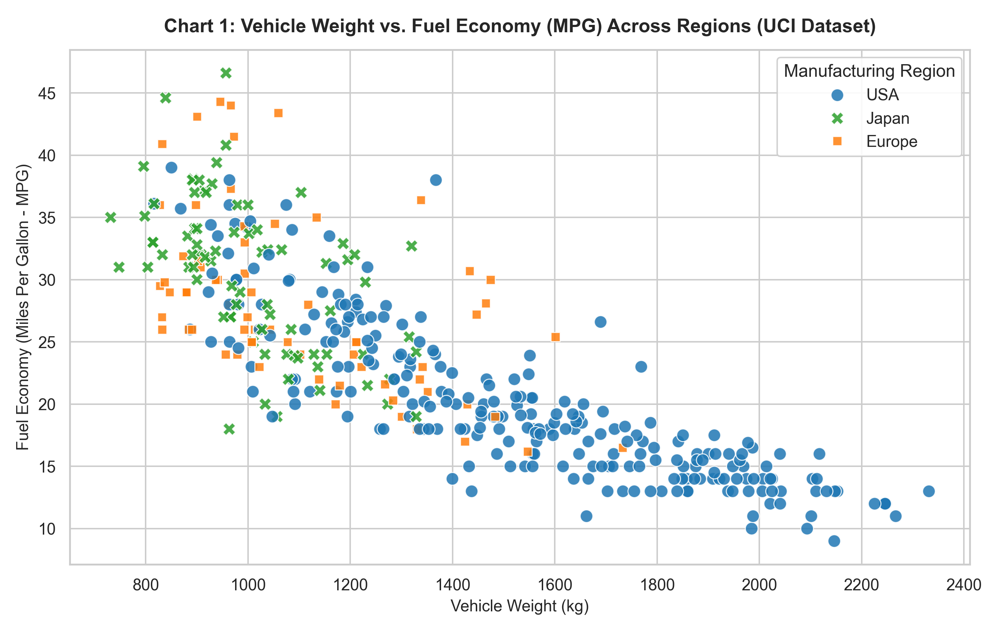
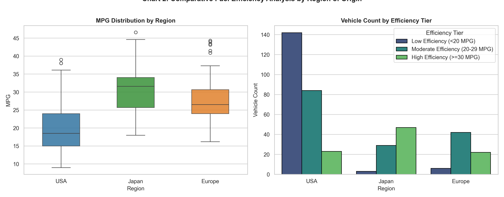

# Understand Python Syntax: Practical Data Analysis on UCI Auto MPG Dataset

[](https://www.python.org/)
[](https://jupyter.org/)
[](https://pandas.pydata.org/)
[](https://numpy.org/)
[](https://matplotlib.org/)
[](https://seaborn.pydata.org/)

A comprehensive, hands-on exploration of **Python syntax** applied to real-world data science workflows, using the benchmark **Auto MPG Dataset** sourced from the **UCI Machine Learning Repository**.

---

## 📌 Dataset Source & Attribution

- **Dataset Name:** Auto MPG Dataset
- **Repository:** [UCI Machine Learning Repository — Auto MPG Dataset](https://archive.ics.uci.edu/dataset/9/auto+mpg)
- **Direct Data URL:** [https://archive.ics.uci.edu/ml/machine-learning-databases/auto-mpg/auto-mpg.data](https://archive.ics.uci.edu/ml/machine-learning-databases/auto-mpg/auto-mpg.data)
- **Original Donor / Citation:** Quinlan, R. (1993). *Combining Instance-Based and Model-Based Learning*, ML93.
- **Dataset Attributes:**
  - `mpg`: Miles per gallon (continuous numeric, fuel economy)
  - `cylinders`: Multi-valued discrete (4, 6, 8, etc.)
  - `displacement`: Engine displacement in cubic inches (continuous)
  - `horsepower`: Engine power (continuous)
  - `weight`: Vehicle weight in pounds (continuous)
  - `acceleration`: Time to accelerate from 0 to 60 mph in seconds (continuous)
  - `model_year`: Multi-valued discrete (year: 70–82)
  - `origin`: Multi-valued discrete (1: USA, 2: Europe, 3: Japan)
  - `car_name`: String (nominal, unique car model name)
- **Total Records:** 398 instances.

---

## 📓 Interactive Notebook (Outputs Visible)

The complete executed Jupyter notebook with all code executions, printed dataframes, type checks, and rendered charts is available directly at:  
👉 **[View Notebook: `understand_python_syntax.ipynb`](understand_python_syntax.ipynb)**

---

## 🗂️ Project Structure

```text
Understand-Python-syntax/
├── .gitignore                              # Git ignore rules for Python & Jupyter
├── README.md                               # Project documentation and summary
├── requirements.txt                        # Project dependencies
├── chart1_mpg_vs_weight.png                # Exported Chart 1 (Scatter plot)
├── chart2_fuel_efficiency_by_origin.png    # Exported Chart 2 (Box & count plots)
├── data/
│   └── auto_mpg.csv                        # Cleaned UCI Auto MPG dataset
└── understand_python_syntax.ipynb          # Executed Jupyter notebook with outputs visible
```

---

## 🚀 Getting Started

### 1. Clone the Repository
```bash
git clone https://github.com/godwintharun3-source/Understand-Python-syntax.git
cd Understand-Python-syntax
```

### 2. Set Up Virtual Environment & Dependencies
```bash
python3 -m venv venv
source venv/bin/activate    # On Windows: venv\Scripts\activate
pip install -r requirements.txt
```

### 3. Launch the Jupyter Notebook
```bash
jupyter notebook understand_python_syntax.ipynb
```

---

## 💻 Python Syntax Walkthrough & Applied Concepts

### 1. Variables, Data Types & Type Casting
```python
sample_row = df.iloc[0]
car_name_str = str(sample_row["car_name"])        # str
cylinders_int = int(sample_row["cylinders"])       # int
mpg_float = float(sample_row["mpg"])               # float
is_efficient_bool = bool(mpg_float >= 20.0)        # bool
```

---

### 2. Built-in Data Structures
- **List Comprehension:** Converting vehicle weight from pounds to kilograms ($1\text{ lb} = 0.453592\text{ kg}$):
  ```python
  df["weight_kg"] = [round(w * 0.453592, 1) for w in df["weight"]]
  ```
- **Dictionary Mapping:** Translating numeric origin codes into geographical regions:
  ```python
  origin_mapping = {1: "USA", 2: "Europe", 3: "Japan"}
  df["origin_name"] = df["origin"].map(origin_mapping)
  ```
- **Sets:** Identifying unique automobile manufacturers without duplicates:
  ```python
  unique_brands = set([name.split()[0].lower() for name in df["car_name"]])
  ```
- **Tuples:** Storing immutable coordinate pairs and thresholds:
  ```python
  EFFICIENCY_THRESHOLDS = (20.0, 30.0)
  ```

---

### 3. Control Flow (`if-elif-else`) & User-Defined Functions
```python
def categorize_efficiency(mpg_value: float) -> str:
    """Categorizes vehicle fuel economy into discrete tiers."""
    if mpg_value >= 30.0:
        return "High Efficiency (>=30 MPG)"
    elif mpg_value >= 20.0:
        return "Moderate Efficiency (20-29 MPG)"
    else:
        return "Low Efficiency (<20 MPG)"

df["efficiency_tier"] = df["mpg"].apply(categorize_efficiency)
```

---

### 4. String Parsing with Lambda Functions
```python
# Extract the first token from composite car names
df["brand"] = df["car_name"].apply(lambda text: text.strip().split()[0].lower())
```

---

### 5. Loops & Regional Performance Summary
```python
regional_summary = []
for idx, region in enumerate(sorted(df["origin_name"].unique()), start=1):
    subset = df[df["origin_name"] == region]
    regional_summary.append({
        "Rank": idx,
        "Region": region,
        "Count": len(subset),
        "Mean_MPG": round(np.mean(subset["mpg"]), 2),
        "Mean_Weight_kg": round(np.mean(subset["weight_kg"]), 1),
        "Mean_Horsepower": round(np.mean(subset["horsepower"]), 1)
    })
summary_df = pd.DataFrame(regional_summary)
```

**Regional Summary Output Table:**
| Rank | Region | Count | Mean MPG | Mean Weight (kg) | Mean Horsepower |
|:---:|:---|:---:|:---:|:---:|:---:|
| 1 | **Europe** | 70 | 27.89 | 1,103.6 kg | 81.0 hp |
| 2 | **Japan** | 79 | **30.45** | **1,007.9 kg** | 79.8 hp |
| 3 | **USA** | 249 | 20.08 | 1,525.0 kg | 118.9 hp |

---

## 📊 Visualizations

### Chart 1: Vehicle Weight vs. Fuel Economy (MPG) Across Regions


### Chart 2: Comparative Fuel Efficiency Analysis by Region of Origin


---

## 🔍 Key Findings in Plain Words

1. **Heavy Vehicles Significantly Reduce Fuel Efficiency ($r = -0.832$):**  
   Vehicle weight is the single strongest negative predictor of mileage. For every 500 kg added, fuel efficiency drops dramatically. Lighter vehicles (~800–1,100 kg) consistently achieve **30 to 45 MPG**, while heavy vehicles (>1,600 kg) struggle below **15 MPG**.
2. **Clear Regional Engineering Differences:**  
   - **Japanese vehicles** lead in fuel efficiency with an average of **30.45 MPG** and an average weight of only **1,008 kg**. Over 55% of Japanese cars fell into the "High Efficiency" tier.  
   - **European vehicles** follow closely at **27.89 MPG** (average weight **1,104 kg**).  
   - **American (USA) vehicles** averaged **20.08 MPG** due to significantly heavier curb weights (averaging **1,525 kg**) and higher cylinder counts (V6 and V8 engines), with 58% categorized as "Low Efficiency".
3. **Cylinder Count and Engine Displacement Trade-Off:**  
   4-cylinder engines dominate high-efficiency vehicles, whereas 8-cylinder engines are strictly limited to low-efficiency vehicles (<18 MPG), demonstrating the clear historical trade-off between power and fuel consumption.
4. **Python Syntax in Practice:**  
   Combining conditional branching (`if-elif-else`), list comprehensions, dictionary mappings, lambda functions, and error handling (`try-except`) creates clean, readable, and highly maintainable data processing pipelines.

---

## 👤 Author
- **Name:** Tharun Godwin C
- **GitHub:** [@godwintharun3-source](https://github.com/godwintharun3-source)
- **Repository:** [Understand-Python-syntax](https://github.com/godwintharun3-source/Understand-Python-syntax)
